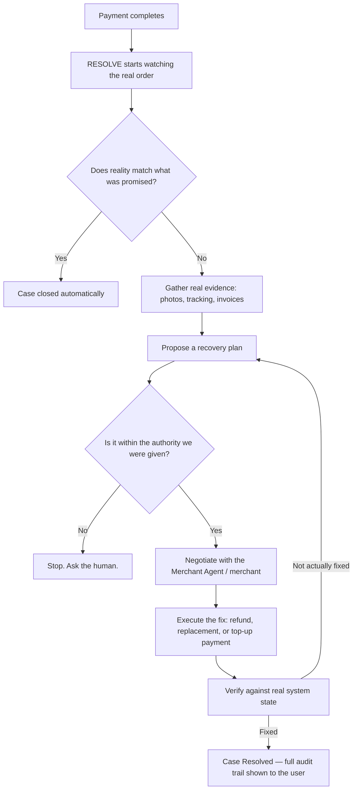
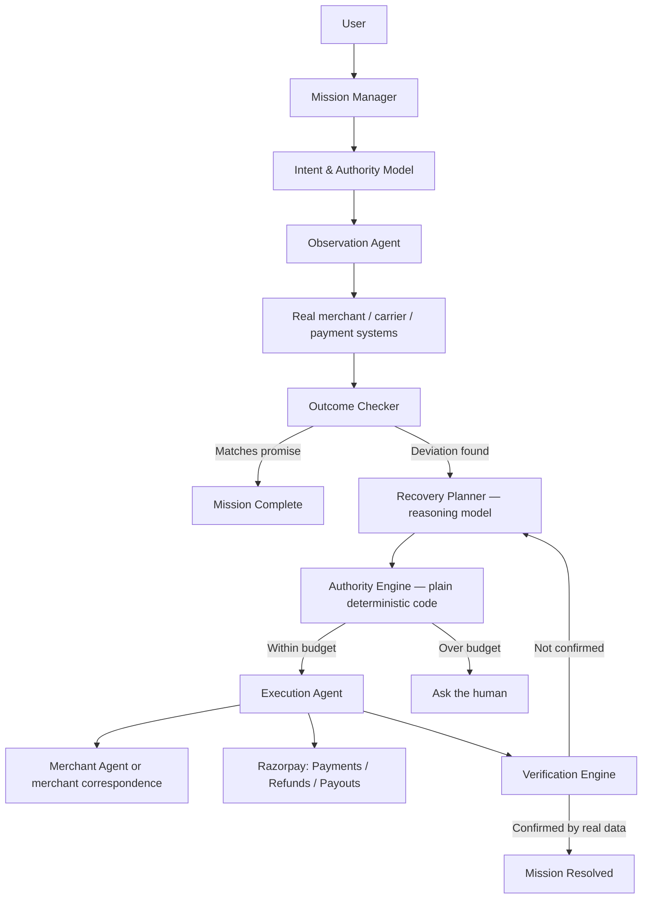

# RESOLVE
### The settlement layer for agent-to-agent commerce disputes

> From "payment completed" to "objective fulfilled."

---

## 1. The Problem, in Plain English

Every new payment protocol being built right now — Google's AP2, OpenAI's ACP, x402, NPCI's UAP — solves the same slice of commerce: an agent discovers a product, builds a cart, gets authorized, and pays. The moment the payment succeeds, every one of these protocols stops caring.

But a successful payment is not a successful outcome. The product can arrive damaged. The wrong item can show up. The package can get lost. The merchant can offer a refund that doesn't actually fix the problem. None of this is visible to a payment system — a payment processor only ever sees "money moved," never "did the buyer get what they actually wanted."

Today, when that gap opens up, a human has to close it by hand: notice something's wrong, dig up the order, find the return policy, email the merchant, argue, wait, follow up again, and eventually get a refund or a replacement — if they're persistent enough. As more purchases start happening through autonomous agents instead of humans, this problem doesn't go away. It gets worse, because now there's no human in the loop to notice the deviation at all.

**Nobody is building the layer that handles this.** Every current effort in agent commerce ends at checkout. We're building the layer that starts there.

---

## 2. The Solution: RESOLVE

RESOLVE is an autonomous agent that takes over the instant a payment completes. The user (or the agent that purchased on their behalf) hands RESOLVE three things:

1. **What they actually wanted** — the real objective, not just "buy item X" (e.g. *a genuine, working camera, landed cost under a set budget, delivered by a set date*).
2. **What "success" looks like** — the conditions that must hold for the objective to count as fulfilled.
3. **A bounded budget of trust** — exactly how much money and which actions RESOLVE is allowed to use *without asking permission first*, and nothing beyond that.

RESOLVE then watches the real transaction — real merchant systems, real logistics tracking, real payment rails — for any deviation from what was promised. When something goes wrong, it doesn't just flag it. It investigates, contacts the merchant, negotiates a fix, executes the recovery through real payment infrastructure, and verifies the fix actually worked, before ever calling the case closed.

### The part nobody else is building: two agents, not one

Most "AI shopping agent" ideas only automate the buyer's side, which means the buyer's agent still has to argue with a human on the merchant's end — the same slow, manual process as today, just with a chatbot doing the typing.

RESOLVE is built so **both sides can be agents.** A Buyer Agent, acting for the customer, and a Merchant Agent, acting for the seller, each hold their own bounded authority and their own policy. When a dispute happens, the two agents exchange evidence and offers directly and settle it — often in under a minute, instead of the eleven days a real complaint typically takes by email. Where a merchant has no agent of their own, RESOLVE simply falls back to writing real, policy-aware correspondence — so the system works today, and gets faster as more merchants adopt the protocol.

**The one rule that makes this trustworthy: neither agent ever has unrestricted control over money.** Every action that spends, refunds, or commits to anything is checked by a separate, plain, deterministic piece of code — not the reasoning model — against the exact budget it was given. If a proposed fix exceeds that budget, it is blocked automatically and sent back to a human, no matter how confident the model is that it's the right call.

---

## 3. How a Case Actually Runs



Every one of those boxes writes a real, timestamped entry to an audit log. Nothing is ever marked "resolved" because an action was *sent* — only because the outcome was *confirmed*, against real data, afterward.

---

## 4. System Architecture

### 4.1 Core object: the Mission

Instead of tracking a case as a chat transcript, RESOLVE tracks it as a structured **Mission** — the single source of truth for everything about that case.

```
Mission
├── Objective            → what the user actually wanted
├── Success Criteria      → how "fixed" is defined
├── Authority             → hard limits: max spend, allowed actions, expiry
├── Transaction            → the real order, payment, and shipment it's tied to
├── Evidence               → real photos, invoices, tracking events, correspondence
├── Negotiation Log        → every offer and counter-offer exchanged
└── Resolution              → what was actually done, and proof it worked
```

### 4.2 The Recovery Mandate

At the moment of purchase, RESOLVE issues a signed **Recovery Mandate** — a portable record of the objective, the success criteria, and the authority granted, that stays alive *after* the payment settles (every existing payment-agent protocol stops at settlement). This is the artifact that lets RESOLVE, the merchant, and the payment provider all agree on what "fixed" actually means, without a human re-explaining it every time.

### 4.3 Component diagram



### 4.4 Why the Authority Engine is the whole point

The reasoning model (LLM) is only ever allowed to **propose** an action — read evidence, draft a plan, negotiate wording, choose a tool. It never touches money or an irreversible action directly. A separate, plain piece of code checks every single proposal against the mission's actual budget before anything is allowed to run:

```
Recovery budget:   ₹10,000
Requested spend:   ₹4,500
Result:            APPROVED → sent to Execution Agent

Recovery budget:   ₹10,000
Requested spend:   ₹15,000
Result:            BLOCKED — exceeds authority → sent to the human
```

This is true on the Merchant Agent's side too — it has its own independent ceiling and can refuse in exactly the same way. Two bounded agents disagreeing, and one of them correctly saying "I can't approve that, here's a human," is the single most important thing this system needs to demonstrate. It's the difference between "an LLM with tool access" and something a bank would actually let touch real money.

---

## 5. Product Experience

The product is two surfaces, not one: a **marketing landing page** that explains RESOLVE to a new visitor, and an **agent workspace** where a live mission is actually run. Both share one design system — pastel, warm, editorial, not a default component-library look.

### 5.1 Design system

| Token | Hex | Use |
|---|---|---|
| `surface` | `#FBFBF9` | Base background |
| `primary-rose` | `#BC6166` | Logo, headlines, dark surfaces |
| `primary-pink` | `#CE8491` | Headlines, buttons on dark-enough surfaces |
| `neutral-sand` | `#D4C4B3` | Section backgrounds |
| `neutral-blush` | `#E7B9AA` | Section backgrounds |
| `accent-terracotta` | `#D27D54` | Primary buttons, callouts, anything that needs to stand out |
| `text-charcoal` | `#32312D` | Body and heading text |

Typography: a serif display face for headlines, paired with a plain, neutral sans for body and UI text — the same pairing that keeps the palette from reading as generic "AI startup" pastel. Components are shadcn/ui primitives, but re-skinned on radius, shadow, and spacing — the unstyled-default look is exactly what makes a project read as a college demo, so nothing ships at its library default.

### 5.2 Landing page (scrollable, one continuous page)

Structured the way a real fintech marketing site is structured — sticky nav, then alternating sections, then a closing CTA, then a full footer — not a single hero and a feature list:

1. **Sticky nav** — logo, Product / How it works / For Merchants / Docs, Sign in, a filled "Start a Mission" button in `accent-terracotta`.
2. **Hero** — headline ("From payment completed to problem solved"), one-line subhead, two CTAs, and a floating product visual: a live-looking Mission card mid-negotiation, the same way a real fintech hero shows a live transaction card rather than a screenshot.
3. **The problem, visually** — a simple before/after: the manual 10-step human recovery flow vs. RESOLVE's loop, side by side.
4. **How it works** — three or four alternating two-column sections, one per stage of the loop (Detect → Negotiate → Execute → Verify), each with a small real UI snippet, not stock illustration.
5. **Why it's safe** — an icon-led benefits grid: Bounded by design, Every action explainable, Nothing executes without verification, Built on real payment rails (Razorpay) — deliberately answering "how do I trust this with money" before anyone has to ask.
6. **For merchants** — a short section on running a Merchant Agent, for the audience on the other side of every mission.
7. **Full-bleed closing CTA** — same visual weight as the hero, in the terracotta/blush gradient, one clear action.
8. **Footer** — About / Product / Support columns, contact, and the usual legal links.

### 5.3 Agent workspace

This is where a real mission runs, and it deliberately mirrors the layout people already know from Claude itself — because that layout is the correct one for "have a running conversation with an agent while it works," not because it's easy to build:

- **Left sidebar** — the user's missions, listed the way a chat sidebar lists conversations: name, status pill (`Active`, `Recovery in progress`, `Resolved`), most recent first.
- **Main panel** — the live activity stream for the selected mission: a running, real-time checklist of what's actually happened (*Evidence collected → Merchant contacted → Offer received → Authority check passed → Payment executed → Delivery confirmed*), plus the negotiation log rendered like a conversation between the Buyer Agent and the Merchant Agent, not a wall of JSON.
- **Bottom prompt box** — always present, for starting a new mission ("Buy this camera from Japan, budget ₹1,20,000...") or giving RESOLVE a follow-up instruction mid-mission, exactly like a chat input.
- **Resolution view** — when a mission closes, a clean summary card: objective, what went wrong, what RESOLVE did, final spend against the authorized ceiling, and a link to the full audit trail underneath.

Nothing on this surface is a scripted loading animation — every line in the activity stream corresponds to a real backend event, which is also the easiest way to make the demo video convincing rather than staged.

---

## 6. Finalized Technology Stack

Chosen so the core logic — the Mission state machine and the Authority Engine — is strong, fully understandable, and testable on its own, rather than optimized for infrastructure that's impressive but opaque.

| Layer | Choice | Why |
|---|---|---|
| **Core API** | Python + FastAPI | Async-native, fast to build on, and pairs naturally with Pydantic |
| **Data models** | Pydantic v2 | Turns Mission / Authority / Mandate / Message into enforced, validated types — not loose JSON floating through the system |
| **Database** | PostgreSQL | System of record: `missions`, `messages` (the negotiation log), and an **insert-only** `audit_log` table — one row per Authority Engine decision, never edited |
| **Mission engine** | A lightweight async scheduler (built on asyncio / APScheduler) | Wakes on a timer, advances every mission that's due — the durable-execution job, kept small enough to fully explain line by line |
| **Authority Engine** | Plain Python module, zero network or model calls | Pure function: given a proposed action and a mission's authority, returns approve or block. Fully unit-tested in isolation — this is the piece that has to be bulletproof |
| **Reasoning layer** | One LLM call site behind a `ReasoningProvider` interface, structured JSON output | Used only for: reading evidence, drafting a recovery plan, negotiation wording. Output is schema-validated before it can touch anything — swapping the model later never touches the Authority Engine |
| **Payments** | Razorpay Python SDK — Payments, Refunds, Payouts (**test mode**) | Idempotency keys on every write; refunds and payouts confirmed via signature-verified webhook, never assumed from the initiating call |
| **Realtime to frontend** | WebSocket (native in FastAPI) | Drives the live activity stream in the agent workspace without polling |
| **Frontend framework** | Next.js (App Router) + TypeScript | Server-rendered landing page for a fast first paint; streaming client components for the live workspace |
| **Styling** | Tailwind CSS, fully custom token config (Section 5.1) | Enforces the design system instead of defaulting to a component-library look |
| **Components** | shadcn/ui primitives, re-skinned | Accessible base, without shipping at default radius/shadow/spacing |
| **Motion** | Framer Motion | Hero and scroll interactions on the landing page |
| **Deployment** | Docker Compose (API + Postgres + frontend) | One command to run the whole system end to end for the demo — no managed infra needed to prove the concept works |

**What's deliberately left out of this version, and why:** a workflow engine like Temporal, object storage, a message queue, and managed auth are all real production upgrades — but none of them are visible in a demo, and all of them would be built without being fully understood on this timeline. The parts that actually get judged — the Mission model, the Authority Engine, the negotiation protocol, and a real Razorpay settlement — get 100% of the effort instead.

---

## 7. What's Actually New Here

Every current effort in agent commerce — the protocols the big platforms are racing to define, and every track built around them — governs discovery, cart, authorization, and payment. All of them stop at the same point: the moment money moves.

RESOLVE starts exactly there. It's not a support chatbot, not a refund bot, not a dispute-resolution protocol in the abstract — it's a bounded, verifiable agent that holds onto what a payment was actually supposed to accomplish, watches it in the real world, and can negotiate with another bounded agent on the other side to put it right, without ever being trusted with more money than it was explicitly given.
